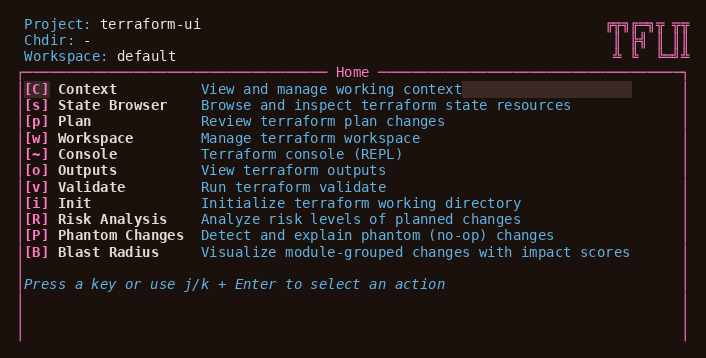

# terraform-ui

A k9s-style interactive terminal UI for Terraform. Plan, analyze risk, inspect blast radius, and apply — all from a keyboard-driven TUI.

**Type:** Go CLI + interactive TUI (BubbleTea)
**Invocation:** `tfui` (TUI), `tfui plan`, `tfui apply` (non-interactive)
**Input:** Terraform root module or monorepo with `tfui.hcl`
**Dependencies:** terraform on `PATH` (another binary via `-terraform-bin`); Go 1.25+ to build from source

## What It Looks Like



## Why

Running `terraform plan` on large modules produces verbose output with no structure. Reviewing state, managing workspaces, and assessing risk requires switching between multiple commands. terraform-ui wraps all of this into a single interactive terminal — navigate changes as a tree, see risk badges inline, pin resources for targeted operations, and apply without leaving the TUI.

## Quick Start

```bash
# Install
brew tap lmarqs/terraform-ui https://github.com/lmarqs/terraform-ui
brew trust --cask lmarqs/terraform-ui/tfui   # Homebrew 7+ only loads trusted third-party casks
brew install --cask tfui

# Or via go install
go install github.com/lmarqs/terraform-ui/cmd/tfui@latest

# Or via mise
mise use github:lmarqs/terraform-ui

# Launch interactive TUI
cd my-terraform-project
tfui

# Or use non-interactive mode
tfui plan --project ./infra
tfui apply --project ./infra
```

## Install

### Homebrew (recommended)

```bash
brew tap lmarqs/terraform-ui https://github.com/lmarqs/terraform-ui
brew trust --cask lmarqs/terraform-ui/tfui   # Homebrew 7+ only loads trusted third-party casks
brew install --cask tfui
```

### Go install

```bash
go install github.com/lmarqs/terraform-ui/cmd/tfui@latest
```

### Binary download

Download `tfui_<version>_<os>_<arch>.tar.gz` (Linux or macOS, amd64 or arm64) from [GitHub Releases](https://github.com/lmarqs/terraform-ui/releases). Extract the binary and place it on your `PATH`.

```bash
# Example: Linux amd64; set VERSION to the release you want, without the leading v
VERSION=1.27.2
curl -sL "https://github.com/lmarqs/terraform-ui/releases/download/v${VERSION}/tfui_${VERSION}_linux_amd64.tar.gz" | tar xz tfui
sudo mv tfui /usr/local/bin/
```

### mise

```bash
mise use github:lmarqs/terraform-ui
```

This adds the tool to your `mise.toml` and installs it. To pin a specific version, append `@<version>` (e.g. `mise use github:lmarqs/terraform-ui@1.4.0`). The latest version is in the [`VERSION`](VERSION) file and on the [releases page](https://github.com/lmarqs/terraform-ui/releases).

## Features

- **Interactive Plan Review** — Navigate changes as a tree, expand attribute diffs, see risk badges
- **Risk Analysis** — Automatic classification of changes as critical/high/medium/low
- **Blast Radius** — See which modules a plan touches, with an impact score for each
- **Phantom Change Detection** — Identify no-op changes that terraform incorrectly reports
- **Live Apply** — Per-resource progress tracking with real-time status
- **State Browser** — Navigate, inspect, taint, untaint, move, and remove state resources
- **Workspace Management** — List, switch, create, and delete workspaces
- **Monorepo Support** — Discover and select chdir members via `tfui.hcl`
- **Pin & Target** — Pin resources with `Space`; the next plan targets only them, and apply applies that plan
- **Headless Mode** — every subcommand runs headless for CI pipelines, scripts and AI agents

## Usage

### Interactive TUI (default)

```bash
tfui                           # TUI in current directory
tfui --project ./infra         # TUI scoped to project directory
tfui --plan ./tfplan.out       # TUI with pre-computed plan
tfui --state ./terraform.tfstate  # TUI with pre-loaded state
```

### Non-Interactive CLI

```bash
# Plan: change list, summary and Risk line on stdout (headless with --ci, or when stderr is not a terminal)
tfui plan --ci
tfui plan --ci -target=aws_instance.web
tfui plan --ci -json                # the plan as JSON (terraform show -json)

# Apply: headless apply needs --auto-approve, which plans and applies in one run
tfui apply --ci --auto-approve
tfui apply --ci --auto-approve -target=aws_instance.web

# State operations
tfui state rm aws_instance.old
tfui state mv aws_instance.old aws_instance.new
tfui import aws_instance.web i-1234567890

# Workspaces
tfui workspace list
tfui workspace select production
tfui workspace new staging
```

Exit codes: `0` success, `1` error, `2` changes present (plan).

### Navigation

| Key | Action |
|-----|--------|
| `p` | Plan |
| `a` | Apply |
| `s` | State browser |
| `w` | Workspaces |
| `o` | Outputs |
| `v` | Validate |
| `R` | Risk analysis |
| `P` | Phantom changes |
| `B` | Blast radius |
| `C` | Context (chdir/workspace) |
| `/` | Filter |
| `:` | Command mode |
| `q` | Quit / back |
| `Space` | Pin a resource (later plans target only pinned resources) |
| `Enter` | Inspect / expand |

## Configuration

Create an optional `tfui.hcl` in your project root for monorepo support:

```hcl
terraform {
  bin = "terraform"
}

member "modules/vpc" {}
member "modules/ecs" {}
member "environments/prod" {}

defaults {
  parallelism = 10
}
```

Without `tfui.hcl`, tfui runs terraform in the project directory with terraform's own defaults. With it, you pick a
member directory, and var-files, variables and lock settings come from the root file, the member's `tfui.hcl` and
the selected workspace.

See [docs/guides/configuration.md](docs/guides/configuration.md) for all options.

## Requirements

- Go 1.25+ (for building from source)
- terraform on `PATH`, or another binary set with `-terraform-bin` or `terraform { bin }` in `tfui.hcl`

## Development

```bash
mise install              # Install tools (go, golangci-lint, terraform, node, ruby, python)
mise run setup            # Bootstrap all dependencies (one command)
mise run dev              # Run TUI in development mode
mise run check:lint       # Lint (golangci-lint)
mise run test:unit        # Unit tests
mise run test:coverage    # Coverage report
mise run build            # Cross-platform binaries (goreleaser snapshot)
```

See [docs/development/testing.md](docs/development/testing.md) for test strategy.

## Documentation

- [Getting Started](docs/guides/getting-started.md) — Installation and first run
- [Configuration](docs/guides/configuration.md) — `tfui.hcl` setup and settings
- [CLI Reference](docs/reference/cli-reference.md) — All commands and flags
- [Architecture](docs/development/architecture.md) — Internal design
- [Plugins](docs/plugins/) — Plugin catalog
- [TUI UX Spec](docs/reference/tui-ux.md) — Navigation and interaction patterns
- [CLI I/O Contract](docs/reference/cli-io-contract.md) — stdout/stderr specification
- [Macro Language](docs/reference/macro-language.md) — Tape DSL for automated testing
- [Roadmap](docs/roadmap.md) — Planned features

## License

MIT
