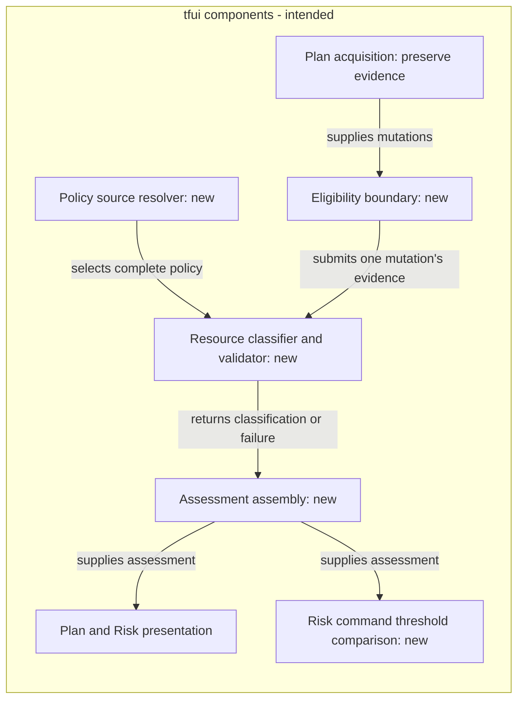
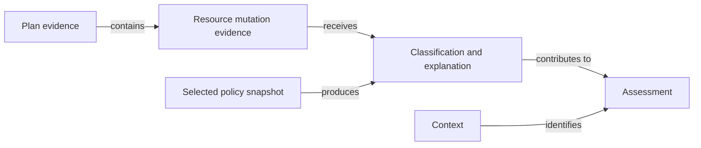
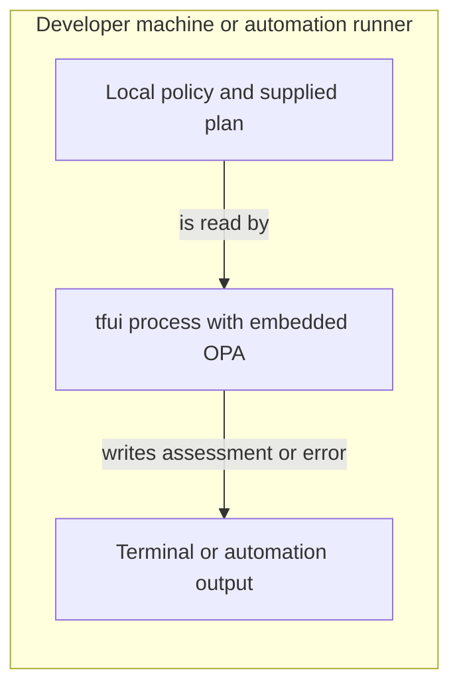

# Risk policy architecture design

The first-version design is accepted under delegated contributor decision authority, for implementation and
post-merge stress review. The coordinator selected the exact interfaces after D-02/D-03 evidence; they are not
owner-selected details. Embedded Rego and independent classification retain their prior accepted boundaries.
The [v1 contract](../reference/risk-policy-contract.md) publishes input, result, source lifecycle, trust,
aggregation and reporting. None of these interfaces is shipped by this document.

The [contract reference](../reference/risk-policy-contract.md) owns definitions and accepted behavior.
[ADR-0024](../adr/0024-embed-rego-for-risk-policies.md) records the language/runtime choice;
[ADR-0025](../adr/0025-classify-resource-mutations-explicitly.md) records purpose and ownership. The
[architecture map](https://github.com/lmarqs/terraform-ui/issues/107) tracks decision work. Implementation work is
in `tasks/prd-risk.md`, not in this design document.

## Decision size and context

The authoring contract is expensive to reverse: policy source and automation become user-owned code. Changing
input meanings or output expectations would require migration. The evaluator implementation is more replaceable
than that public boundary, so prototype evidence must precede a stable interface.

The current classifier uses action and fixed resource-type lists in `internal/terraform/risk.go`. Plan displays
its levels. Risk can group an explicitly supplied summary, but its production activation/event path and dedicated
command are absent; `Configure` ignores options. The gap is observed capability, not measured usage or performance.
No user-frequency or author-expertise measurements were supplied; D-03c costs are recorded below.

| Role | What exists today | Evidence |
| --- | --- | --- |
| Infrastructure reviewer | Fixed risk badges in Plan and overall risk in headless Plan text. | `plugins/plan`, `pkg/sdk/risk.go`. |
| Project policy author | No supported custom risk rules. | `plugins/risk/risk.go` ignores configuration options. |
| Automation author | Can obtain a plan; no dedicated risk command. | `cmd/tfui/main.go`. |
| Member maintainer | Member plugin blocks are rejected; a dedicated policy selector is planned. | `internal/config/hcl_resolve.go`, `internal/config/hcl_child.go`; the [historical report](https://github.com/lmarqs/terraform-ui/issues/98) predates rejection. |

`PlanChange` contains formatted strings, not the complete typed evidence needed by a policy. `ParsePlan` filters
reads/no-ops and builds a presentation summary. Its sensitive handling recognizes top-level boolean masks, not
nested masks. `LoadPlan` and `ExecService.Plan` classify that summary before phantom detection. Phantom normalization
sorts arrays and removes null-valued object keys; these transformations cannot establish that every marked mutation
is harmless. These are code observations, not provider-specific semantic proofs.

The initial seeded-plan cache short-circuit already exists in `ExecService.Plan`. `WithDir` creates a fresh cache,
and startup/context wiring needs verification. `Registry.Build` discards configuration errors, and
`App.withResolvedConfig` updates execution settings without reconfiguring policy options. A policy lifecycle
cannot be obtained merely by adding a `Configure` method.

Blast Radius also consumes `PlanChange.Risk` when computing resource impact in
`plugins/blastradius/blastradius.go`. Changing the shared representation therefore affects a consumer beyond
Plan and Risk even without editing its plugin. The intended treatment of custom, unavailable or partial
assessments in that consumer needs an explicit decision; a zero-valued severity must not become an accidental
interpretation of failure.

## Goals, stakeholders and prior decisions

| Goal | Beneficiary | Observable success |
| --- | --- | --- |
| G1: Understand which planned mutations need attention and why. | Reviewer | A representative mutation has an attributable classification and visible change. |
| G2: Express project expectations without waiting for a tfui release. | Policy author | A policy edit changes the intended classification without changing tfui. |
| G3: Distinguish a completed assessment from a failed assessment before deciding what to do. | Human or automation caller | Failure cannot appear as a successful neutral result. |
| G4: Control a Member's assessment without hidden contributions. | Member maintainer | The selected policy alone owns each classification. |

The owner represents these usage roles and delegated the first-version interface choices to contributors.
The coordinator owns publication review; the owner stresses and refines the result after merge. Maintainers bear
the dependency and compatibility cost; policy authors bear Rego learning and completeness obligations. These are
tradeoffs, not measured adoption outcomes. No external legal, contractual or signed-budget constraint has been
established.

| Prior decision | Source | Cost to reverse |
| --- | --- | --- |
| Embedded Rego; HCL selects local source. | Owner, ADR-0024. | Migrate authored policies and evaluator integration. |
| Independent classification; explicit completeness and no fallback. | Owner, ADR-0025. | Change the meaning of existing classifications and defaults. |
| Complete Member policy replacement and explicit templates. | Owner, ADR-0024. | Introduce inheritance and upgrade semantics authors did not choose. |
| Apply remains unchanged. | Owner, both ADRs. | Reopen execution and saved-artifact lifecycle scope. |
| Plugins depend only on SDK domain types. | Repository architecture and conventions. | Couple plugins to application/evaluator internals. |
| Shared Plan/Risk action and diff presentation. | Owner's UI review. | Duplicate presentation logic and risk divergent masking/styles. |

Earlier exploratory suggestions for first-match-wins and automatic phantom suppression are not contract
requirements. Phantom suppression was explicitly rejected during the resource-classification discussion.

## Requirements and proof scenarios

The following requirements express accepted boundaries and the requested feature. Each proof is work to perform,
not a claim that the implementation or test already exists. The contract fixes author workflow and the limited trusted-author disclosure boundary; production tests
still need to establish that implementation meets them.

| ID | Goal | Requirement | Scenario and proof |
| --- | --- | --- | --- |
| R1 | G1,G2 | Authors classify each submitted resource mutation independently and explain it. | Evaluate the same mutation beside different neighboring changes; its classification does not change and policy input exposes no cross-resource data. |
| R2 | G1,G3 | Every eligible mutation receives explicit classification or assessment failure. | Undefined/missing/invalid output fails; a policy's explicit default succeeds. Reads and pure moves are not assessed, not classified `none`. |
| R3 | G2,G4 | Selected custom policy fully owns classification and replaces the inherited policy. | A Lambda-only custom policy encounters a database deletion: explicit default or failure, never built-in fill-in; switching Member selects only its effective source. |
| R4 | G1,G3 | Plan remains inspectable when assessment fails, with risk explicitly unavailable; risk command reports an error. | Break policy compilation/result validation; inspect the original plan, observe unavailable risk and a command error, with no Apply behavior change. |
| R5 | G1,G3 | Review and reporting use classifications from the same plan and selected policy. | Compare live/seeded Plan and Risk results and count plan calls; opening Risk after Plan does not generate a second plan. |
| R6 | G1,G2 | Attribute-aware rules can distinguish the resource mutation they explain. | Compare Lambda filename and memory-only updates with unchanged/null/unknown hashes; the reason names evidence without inventing external ownership. |
| R7 | G1,G4 | Assessment identity follows the plan, selected policy and active Context. | Switch A to B while A evaluates; late A results cannot appear as B's assessment. Same-path source edits follow the agreed reload semantics. |
| R8 | G1 | Reviewers see the changed attributes with the classification using shared presentation conventions. | Inspect narrow and long plans; inline diffs, action symbols, masking and full inspection remain consistent with Plan. |

There is no justified numerical latency, memory or binary-size target. Record baseline and candidate measurements
before judging their costs. D-03c records the delegated first-version acceptance below. Do not invent a non-functional guarantee from cooperative cancellation or
an untested dependency declaration.

## Architectural shape

The following components describe responsibilities, not new public Go abstractions already approved for coding.
The acquisition boundary preserves structured evidence from the plan being reviewed (R5,R6). The eligibility
boundary applies the accepted resource-mutation scope (R1,R2). A source resolver selects one complete policy for
the Context (R3,R7); a custom source replaces built-in classification rather than supplementing it.

The classifier evaluates only one resource mutation's permitted evidence and validates its result (R1,R2,R6).
OPA stays inside app internals behind SDK-facing domain values. tfui aggregates complete classifications and
performs threshold comparison (R4,R5); use the maximum of a nonempty complete assessment and an opt-in inclusive threshold from the contract. Plan and Risk consume
the same assessment and presentation primitives (R5,R8). Error propagation distinguishes an unusable assessment
from an unusable Terraform plan (R4).



*Figure 1. Component view inside tfui. Answers R1–R8. These responsibilities may share implementation modules.*

```mermaid
sequenceDiagram
  participant S as Source resolver
  participant A as Plan acquisition
  participant C as Classifier and validator
  participant G as Assessment assembly
  participant P as Plan and Risk
  S->>C: Select complete policy for Context
  A->>G: Supply reviewed plan evidence
  loop Each eligible mutation
    G->>C: Submit only this mutation's permitted evidence
    C-->>G: Explicit classification or failure
  end
  alt Assessment failed
    G-->>P: Risk unavailable and visible error
    Note over P: Plan stays reviewable; risk command errors
  else Assessment completed
    G-->>P: Classifications with explanations
  end
```

*Figure 2. Assessment sequence at component level. Answers R1–R7. Empty and partial statuses follow the v1 contract; partial results have no aggregate.*



*Figure 3. Conceptual data ownership view. Answers R1–R3,R5,R7; not a serialized schema.*



*Figure 4. Deployment view. Answers R3–R5 and records the accepted embedded-runtime boundary.*

## Alternatives and tradeoffs

Drivers, in order: explicit and independently explainable classification (R1–R4); project ownership without hidden
contributions (R3); fidelity and consistent review (R5–R7); reusable authoring/testing and maintenance cost; shared
presentation (R8). The owner rejected broader cross-resource analysis as unnecessary for the initial plugin.

All integrated options need same-plan evidence, eligibility, validation, Context identity and report semantics.
Those obligations do not disappear by choosing OPA. The language choice is retained despite the narrower scope;
CEL remains a credible alternative if embedding evidence justifies reopening ADR-0024. Impact and likelihood below
are qualitative estimates with reasons, not measured incident rates.

| Option | Requirements met or missed | Advantages | Costs and risk | Impact / likelihood | Mitigation | Contingency |
| --- | --- | --- | --- | --- | --- | --- |
| Baseline: fixed classifier plus Lambda rule | R1,R6 for fixed cases; misses project control in R3 | Small change, no author language | Each new rule needs a release | Medium / high given requested customization | Keep current rules documented | Adopt configurable classification |
| Custom HCL/YAML matcher | R1–R3,R6 for supported operators; integration still needed | Simple small policies | tfui owns operator growth, precedence and tests | High / medium as attribute cases expand | Bound supported operations | Migrate authored rules |
| Embedded CEL predicates | Can meet R1–R7 with an envelope and harness | Fits independent predicates | tfui owns surrounding policy/result/test conventions | Medium / medium because those conventions remain work | Keep the envelope narrow | Reconsider standard policy modules |
| Embedded Rego, selected | Supports R1–R7; tfui must enforce boundaries | Standard language and author test tooling | Learning, dependency upgrades, 15.0–16.2MiB added binary size | High for maintenance / medium given older toolchain-driven pin | Trusted authors, pinned capabilities, measured release matrix | Rerun controls and revise pin/profile explicitly |
| External OPA or Conftest | Can meet R1–R7 with adaptation | Independent evaluator upgrades | Extra installation and process/version handling | Medium / medium for distributed CLI users | Supported version and explicit discovery | Embed the evaluator |
| External CI only | R1–R3,R6 possible; misses integrated R5,R8 | Least tfui integration | Divergent review and automation evidence | High / high without result integration | Share inputs and fixtures | Add integrated assessment |
| Plan-wide policy, rejected | Fails independent R1 | Combined-change and compliance rules | Resource classifications depend on other changes | High scope cost / high by definition | Explicit broader contract | Separate future feature |
| Sparse results with fallback, rejected | Fails R2,R3 | Authors write only exceptions | Missing output silently changes ownership | High / high by definition | Explicit default in selected policy | Fail incomplete assessment |
| Automatic phantom suppression, rejected | Fails R2 | Less noise | Normalization may erase meaningful evidence | High / medium from array/null counterexamples | Submit mutations normally | Review heuristic separately |
| Parent mixing or named presets, rejected | Mixing fails R3 | Less copied source | Hidden policy and upgrade semantics | High / medium with layered configuration | Explicit copied templates | Reconsider explicit composition separately |
| Plugin-local diff rendering, rejected | Fails R8 consistency intent | Fast isolated implementation | Divergent styles, unknown and sensitive handling | Medium / medium with duplicate formatters | Share existing renderer through SDK | Consolidate duplicated rendering |

Changing Apply is an alternative enforcement location, but it reverses the owner's explicit scope and adds
execution/artifact obligations without improving independent classification. There is no external constraint
prohibiting it; it is deliberately excluded from this feature.

## Evidence and limits

The [Lambda field report](https://github.com/lmarqs/terraform-ui/issues/106) describes Terraform uploading a
placeholder package over code deployed by another pipeline when a tracked package path changes. The AWS provider
source inspected during the language decision includes `filename` in its code-update check, reads the file and
calls `UpdateFunctionCode`. This supports the mechanism, not a reproduction against an unspecified reporter
version. An unchanged/null hash does not establish placeholder contents, lifecycle-ignore configuration or
external deployment ownership. Neither blanket lowering of non-code updates nor layer classifications is accepted.

The [versioned OPA research](risk-policy-runtime-research.md) establishes that an undefined query may return no Go
error; strict builtin error handling is explicit; print suppression cannot prevent secrets in returned values;
and cancellation is cooperative. It originally identified a Go-compatible declaration only. Subsequent D-03b/c evidence below tests the
selected v1.19.1 runtime boundary and combined builds/costs; the original research alone did not establish them.

## First-version decision map

This local map records outcomes for the [architecture tracking map](https://github.com/lmarqs/terraform-ui/issues/107).
It does not claim remote tickets or their statuses were updated. Each exact interface now lives in the reference;
D-01a/b pages remain historical candidate/evidence provenance. No public-contract choice remains delegated to an
implementation story. Production implementation and regression proof remain separate work.

| Boundary / original decision ticket | First-version outcome and authoritative definition | Evidence / remaining implementation proof |
| --- | --- | --- |
| Input, #109 | [Tagged single-mutation envelope](../reference/risk-policy-contract.md#input-v1), exact numeric tokens, ordered actions/lists, opaque unknown/sensitive subtrees. | [D-02a](risk-policy-evidence/input-fidelity.md): display strings lose numbers; validate masks before collapse in production. |
| Source, #110 | [Dedicated declaration-relative selector](../reference/risk-policy-contract.md#source-selection), complete replacement, immutable framed digest, reload boundaries and generation guard. | [D-02c](risk-policy-evidence/context-source-identity.md): model supports identity; real strict selector/reload/race integration remains US-002/004. |
| Trust, #112 | [Trusted local authors, redaction, reduced positive capabilities](../reference/risk-policy-contract.md#runtime-and-trust-boundary); no sandbox or hard termination promise. | [D-03b](risk-policy-evidence/boundary-controls.md): forty bounded cases; print needs AST rejection, raw errors disclose authored text. |
| Result, #114 | [One complete-document result](../reference/risk-policy-contract.md#result-v1-and-rule-resolution), strict shape, conflicting objects fail; partial rows retained only in review. | D-03b separates undefined, invalid, conflict and executed builtin errors; full reason/path validator tests remain US-003. |
| Packaging, #115 | [Explicit vendored helpers/templates](../reference/risk-policy-contract.md#helpers-templates-and-upgrades); current built-in severities retained, including [Lambda choices](../reference/risk-policy-contract.md#lambda-first-version-choices). | Source inspection and D-01b rationale; complete attribute templates and author tests remain US-007. |
| Runtime, #116 | OPA v1.19.1 initial integration pin; accept measured cost under delegated authority, without security/support or numerical-budget claim. | [D-03c](risk-policy-evidence/release-costs.md): all four release builds; native runtime only Linux/amd64. Review advisories and regression-test MVS upgrades in US-003. |
| Reporting, #117 | [Maximum only for complete nonempty assessment, inclusive opt-in threshold, report v1](../reference/risk-policy-contract.md#command-threshold-and-report-v1); [channel/exit extension](../reference/cli-io-contract.md#risk-command-v1). | Exact identities, empty/none/partial distinctions and level migration published; command/session proof remains US-006/008. |
| Consumers/review, #118 | [Selected-policy Blast Radius inputs](../reference/risk-policy-contract.md#blast-radius-compatibility-decision), unchanged impact arithmetic, explicit unavailable groups/banner. | Current arithmetic reviewed; validity representation and regression tests remain US-004. |
| Architecture map, #107 | [ADR-0026](../adr/0026-publish-first-version-risk-contract.md) publishes the first version under delegation. | [Publication review](risk-policy-evidence/contract-publication.md) consolidates decisions and residual risks; no feature completion claim. |

## Consequences and confirmation

The coordinator selects the first version under the owner's explicit delegation, using evidence and an agent
review; the owner refines it after merge. This replaces the earlier wait for exact owner selection. No new
stakeholder preference is inferred. Independent classification sacrifices combined-change rules; complete custom
ownership requires explicit defaults. Tagged values cost author ergonomics; explicit vendoring costs upgrades;
redaction prevents policies inspecting sensitive values. In return, classification has one owner and a bounded
evidence base. Maintainers own dependency upgrades, input fidelity and public compatibility.

**Measured**, D-03c: binary growth is 15.0–16.2MiB (~177–178%); cold builds add ~12.6–13.0 seconds; combined
N=1000 warm evaluation median is 23.049µs per mutation with maximum observed RSS 28.375MiB. Accept these costs
for the first version's single binary and explicit policies, without inventing a budget. These are small-policy
Linux/amd64 results, not worst-case complete-policy or non-host runtime guarantees. See full ranges/method in
[D-03c](risk-policy-evidence/release-costs.md).

| Residual risk | Mitigation and confirmation | If it materializes |
| --- | --- | --- |
| Older toolchain-driven runtime pin and shared dependency upgrades | Advisory/maintenance review and all product regressions in US-003; repeat frozen controls on changes. | Revise the pin/toolchain/profile explicitly, rerun release matrix; never silently broaden capabilities. |
| Misleading reasons or unmarked/authored secrets | Trusted authors, marked-value redaction, fixed diagnostics, plain-text validation. | Correct source/input marking; do not claim confidentiality certification. |
| Opaque ancestor hides invalid child masks | Validate full source masks before projection, including malformed opaque ancestors in US-001/003. | Unavailable assessment; no guessed nodes or fallback. |
| Lost reviewed evidence or startup seed | Preserve raw evidence in acquisition; real Session tests with nonexistent Terraform and initial Chdir in US-001. | Fix seed propagation; never retrieve evidence by a second PlanJSON plan. |
| Stale source/Context results or concurrent filesystem edits | Immutable snapshot, recheck selection/content and generation before publish; real A/B tests in US-004. | Discard late results and expose source-changed/unavailable state. No hostile-filesystem atomicity promise. |
| Slow/nonterminating trusted source or cancellation | Bounded experiments, cooperative cancellation and lifecycle terminal tests. | Review policy and runtime; hard isolation would require a separate design. |
| Changed consumer meaning or command output | Blast Radius arithmetic regressions, empty/partial/threshold boundary and stdout tests in US-004/006/008. | Fix integration before claiming implemented support. |
| Provider-version differences and unknown inputs | Evidence-based reasons, no inferred pipeline ownership, explicit uncertainty and normal phantom eligibility. | Correct fixtures/rules explicitly; unsupported input fails assessment. |

Confirmation is the downstream PRD's behavior proof, including source-switch, undefined/conflicting result,
nested-sensitive/unknown/null, both replacements, phantom, cancellation and real session/CLI scenarios. Contract
publication is design acceptance only. Revisit after merge and each runtime/profile/schema revision; a breaking
interface revision requires a new major per the contract. The PRD owns sequencing and completion.

## Sources and history

- Repository code inspected for this documentation: `pkg/sdk/change.go`, `pkg/sdk/risk.go`, `plugins/risk/risk.go`,
  `internal/terraform/{risk,phantom,plan_parser,loader}.go`, `internal/terraform/exec/service.go`,
  `internal/config/hcl_resolve.go`, `internal/plugin/registry.go`, `internal/ui/app.go`.
- Owner discussion and [assessment-purpose ticket](https://github.com/lmarqs/terraform-ui/issues/108): explicit
  philosophy, independent classifications, completeness, custom ownership, eligibility and failure behavior.
- [OPA integration](https://www.openpolicyagent.org/docs/integration),
  [OPA policy tests](https://www.openpolicyagent.org/docs/policy-testing), [CEL](https://cel.dev/),
  [Conftest](https://www.conftest.dev/): language-selection evidence, with pinned runtime evidence on the research page.
- [AWS Lambda provider implementation](https://github.com/hashicorp/terraform-provider-aws/blob/main/internal/service/lambda/function.go):
  upstream source inspected 2026-11-14 during the language decision; not a pinned-version reproduction.
- 2026-11-14: language/runtime accepted; subsequent owner discussion settled scope and explicit ownership. The
  working analysis was consolidated into `docs/`; remaining public interface choices retain proposed status.

- 2026-11-15: delegated first-version publication after D-02/D-03 evidence; exact interfaces now live in the reference.
