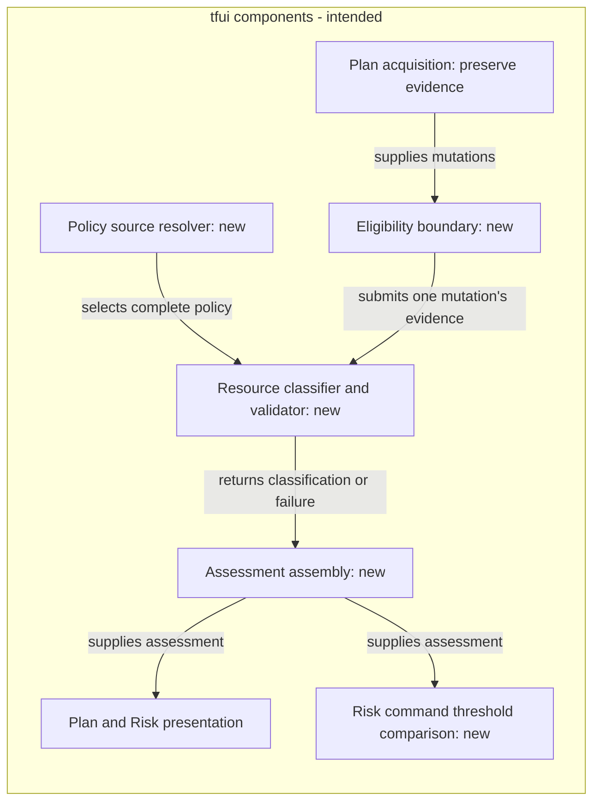
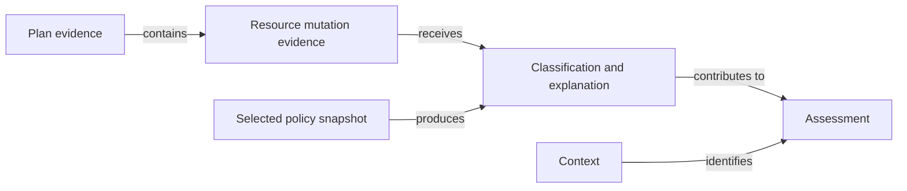
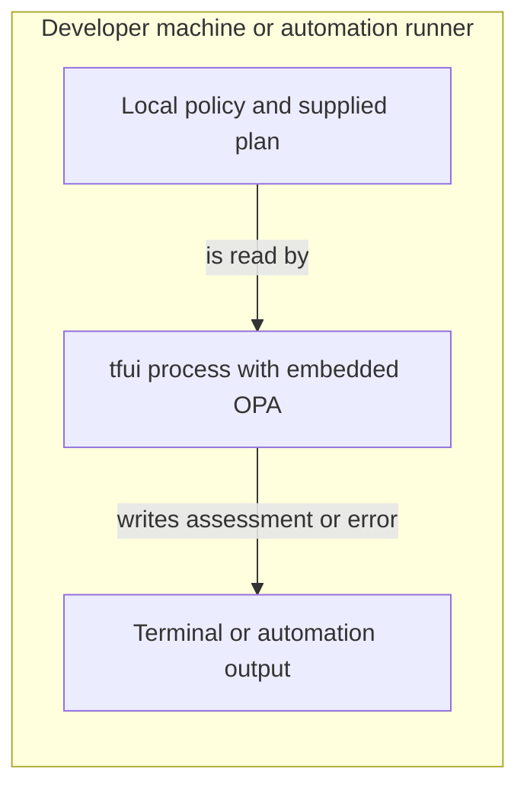

# Risk policy architecture design

Embedded Rego and the independent resource-classification boundary are accepted. The complete interface design
remains proposed: input/result representation, sensitive-data access, evaluator capabilities, aggregation,
thresholds and source lifecycle still need decisions. No custom-policy API is shipped by this document.

The [contract reference](../reference/risk-policy-contract.md) owns definitions and accepted behavior.
[ADR-0024](../adr/0024-embed-rego-for-risk-policies.md) records the language/runtime choice;
[ADR-0025](../adr/0025-classify-resource-mutations-explicitly.md) records purpose and ownership. The
[architecture map](https://github.com/lmarqs/terraform-ui/issues/107) tracks decision work. Implementation work is
in `tasks/prd-risk.md`, not in this design document.

## Decision size and context

The authoring contract is expensive to reverse: policy source and automation become user-owned code. Changing
input meanings or output expectations would require migration. The evaluator implementation is more replaceable
than that public boundary, so prototype evidence must precede a stable interface.

The current classifier uses action and fixed resource-type lists in `internal/terraform/risk.go`. Plan displays
its levels. Risk can group an explicitly supplied summary, but its production activation/event path and dedicated
command are absent; `Configure` ignores options. The gap is observed capability, not measured usage or performance.
No user-frequency, author-expertise, latency or memory measurements were supplied.

| Role | What exists today | Evidence |
| --- | --- | --- |
| Infrastructure reviewer | Fixed risk badges in Plan and overall risk in headless Plan text. | `plugins/plan`, `pkg/sdk/risk.go`. |
| Project policy author | No supported custom risk rules. | `plugins/risk/risk.go` ignores configuration options. |
| Automation author | Can obtain a plan; no dedicated risk command. | `cmd/tfui/main.go`. |
| Member maintainer | Plugin options are merged by key internally; this does not establish working policy overrides. | `internal/config/hcl_resolve.go`, [ignored member plugin block report](https://github.com/lmarqs/terraform-ui/issues/98). |

`PlanChange` contains formatted strings, not the complete typed evidence needed by a policy. `ParsePlan` filters
reads/no-ops and builds a presentation summary. Its sensitive handling recognizes top-level boolean masks, not
nested masks. `LoadPlan` and `ExecService.Plan` classify that summary before phantom detection. Phantom normalization
sorts arrays and removes null-valued object keys; these transformations cannot establish that every marked mutation
is harmless. These are code observations, not provider-specific semantic proofs.

The initial seeded-plan cache short-circuit already exists in `ExecService.Plan`. `WithDir` creates a fresh cache,
and startup/context wiring needs verification. `Registry.Build` discards configuration errors, and
`App.withResolvedConfig` updates execution settings without reconfiguring policy options. A policy lifecycle
cannot be obtained merely by adding a `Configure` method.

Blast Radius also consumes `PlanChange.Risk` when computing resource impact in
`plugins/blastradius/blastradius.go`. Changing the shared representation therefore affects a consumer beyond
Plan and Risk even without editing its plugin. The intended treatment of custom, unavailable or partial
assessments in that consumer needs an explicit decision; a zero-valued severity must not become an accidental
interpretation of failure.

## Goals, stakeholders and prior decisions

| Goal | Beneficiary | Observable success |
| --- | --- | --- |
| G1: Understand which planned mutations need attention and why. | Reviewer | A representative mutation has an attributable classification and visible change. |
| G2: Express project expectations without waiting for a tfui release. | Policy author | A policy edit changes the intended classification without changing tfui. |
| G3: Distinguish a completed assessment from a failed assessment before deciding what to do. | Human or automation caller | Failure cannot appear as a successful neutral result. |
| G4: Control a Member's assessment without hidden contributions. | Member maintainer | The selected policy alone owns each classification. |

The owner represents these usage roles and makes the architecture decisions after consultation. Maintainers bear
the dependency and compatibility cost; policy authors bear Rego learning and completeness obligations. These are
tradeoffs, not measured adoption outcomes. No external legal, contractual or signed-budget constraint has been
established.

| Prior decision | Source | Cost to reverse |
| --- | --- | --- |
| Embedded Rego; HCL selects local source. | Owner, ADR-0024. | Migrate authored policies and evaluator integration. |
| Independent classification; explicit completeness and no fallback. | Owner, ADR-0025. | Change the meaning of existing classifications and defaults. |
| Complete Member policy replacement and explicit templates. | Owner, ADR-0024. | Introduce inheritance and upgrade semantics authors did not choose. |
| Apply remains unchanged. | Owner, both ADRs. | Reopen execution and saved-artifact lifecycle scope. |
| Plugins depend only on SDK domain types. | Repository architecture and conventions. | Couple plugins to application/evaluator internals. |
| Shared Plan/Risk action and diff presentation. | Owner's UI review. | Duplicate presentation logic and risk divergent masking/styles. |

Earlier exploratory suggestions for first-match-wins and automatic phantom suppression are not contract
requirements. Phantom suppression was explicitly rejected during the resource-classification discussion.

## Requirements and proof scenarios

The following requirements express accepted boundaries and the requested feature. Each proof is work to perform,
not a claim that the implementation or test already exists. Fixture-based author tooling and the precise
non-disclosure/trust promise still need confirmation in the remaining design decisions.

| ID | Goal | Requirement | Scenario and proof |
| --- | --- | --- | --- |
| R1 | G1,G2 | Authors classify each submitted resource mutation independently and explain it. | Evaluate the same mutation beside different neighboring changes; its classification does not change and policy input exposes no cross-resource data. |
| R2 | G1,G3 | Every eligible mutation receives explicit classification or assessment failure. | Undefined/missing/invalid output fails; a policy's explicit default succeeds. Reads and pure moves are not assessed, not classified `none`. |
| R3 | G2,G4 | Selected custom policy fully owns classification and replaces the inherited policy. | A Lambda-only custom policy encounters a database deletion: explicit default or failure, never built-in fill-in; switching Member selects only its effective source. |
| R4 | G1,G3 | Plan remains inspectable when assessment fails, with risk explicitly unavailable; risk command reports an error. | Break policy compilation/result validation; inspect the original plan, observe unavailable risk and a command error, with no Apply behavior change. |
| R5 | G1,G3 | Review and reporting use classifications from the same plan and selected policy. | Compare live/seeded Plan and Risk results and count plan calls; opening Risk after Plan does not generate a second plan. |
| R6 | G1,G2 | Attribute-aware rules can distinguish the resource mutation they explain. | Compare Lambda filename and memory-only updates with unchanged/null/unknown hashes; the reason names evidence without inventing external ownership. |
| R7 | G1,G4 | Assessment identity follows the plan, selected policy and active Context. | Switch A to B while A evaluates; late A results cannot appear as B's assessment. Same-path source edits follow the agreed reload semantics. |
| R8 | G1 | Reviewers see the changed attributes with the classification using shared presentation conventions. | Inspect narrow and long plans; inline diffs, action symbols, masking and full inspection remain consistent with Plan. |

There is no justified numerical latency, memory or binary-size target. Record baseline and candidate measurements
before the owner judges their costs. Do not invent a non-functional guarantee from cooperative cancellation or
an untested dependency declaration.

## Architectural shape

The following components describe responsibilities, not new public Go abstractions already approved for coding.
The acquisition boundary preserves structured evidence from the plan being reviewed (R5,R6). The eligibility
boundary applies the accepted resource-mutation scope (R1,R2). A source resolver selects one complete policy for
the Context (R3,R7); a custom source replaces built-in classification rather than supplementing it.

The classifier evaluates only one resource mutation's permitted evidence and validates its result (R1,R2,R6).
OPA stays inside app internals behind SDK-facing domain values. tfui aggregates complete classifications and
performs threshold comparison (R4,R5); the formula and command settings remain unresolved. Plan and Risk consume
the same assessment and presentation primitives (R5,R8). Error propagation distinguishes an unusable assessment
from an unusable Terraform plan (R4).



*Figure 1. Component view inside tfui. Answers R1–R8. These responsibilities may share implementation modules.*

```mermaid
sequenceDiagram
  participant S as Source resolver
  participant A as Plan acquisition
  participant C as Classifier and validator
  participant G as Assessment assembly
  participant P as Plan and Risk
  S->>C: Select complete policy for Context
  A->>G: Supply reviewed plan evidence
  loop Each eligible mutation
    G->>C: Submit only this mutation's permitted evidence
    C-->>G: Explicit classification or failure
  end
  alt Assessment failed
    G-->>P: Risk unavailable and visible error
    Note over P: Plan stays reviewable; risk command errors
  else Assessment completed
    G-->>P: Classifications with explanations
  end
```

*Figure 2. Assessment sequence at component level. Answers R1–R7. Empty-set and partial-result encoding remain open.*



*Figure 3. Conceptual data ownership view. Answers R1–R3,R5,R7; not a serialized schema.*



*Figure 4. Deployment view. Answers R3–R5 and records the accepted embedded-runtime boundary.*

## Alternatives and tradeoffs

Drivers, in order: explicit and independently explainable classification (R1–R4); project ownership without hidden
contributions (R3); fidelity and consistent review (R5–R7); reusable authoring/testing and maintenance cost; shared
presentation (R8). The owner rejected broader cross-resource analysis as unnecessary for the initial plugin.

All integrated options need same-plan evidence, eligibility, validation, Context identity and report semantics.
Those obligations do not disappear by choosing OPA. The language choice is retained despite the narrower scope;
CEL remains a credible alternative if embedding evidence justifies reopening ADR-0024. Impact and likelihood below
are qualitative estimates with reasons, not measured incident rates.

| Option | Requirements met or missed | Advantages | Costs and risk | Impact / likelihood | Mitigation | Contingency |
| --- | --- | --- | --- | --- | --- | --- |
| Baseline: fixed classifier plus Lambda rule | R1,R6 for fixed cases; misses project control in R3 | Small change, no author language | Each new rule needs a release | Medium / high given requested customization | Keep current rules documented | Adopt configurable classification |
| Custom HCL/YAML matcher | R1–R3,R6 for supported operators; integration still needed | Simple small policies | tfui owns operator growth, precedence and tests | High / medium as attribute cases expand | Bound supported operations | Migrate authored rules |
| Embedded CEL predicates | Can meet R1–R7 with an envelope and harness | Fits independent predicates | tfui owns surrounding policy/result/test conventions | Medium / medium because those conventions remain work | Keep the envelope narrow | Reconsider standard policy modules |
| Embedded Rego, selected | Supports R1–R7; tfui must enforce boundaries | Standard language and author test tooling | Learning, dependencies and unmeasured runtime costs | High if adoption/builds fail / medium while unmeasured | Templates, capability review, bounded spike | Reopen runtime choice before stable publication |
| External OPA or Conftest | Can meet R1–R7 with adaptation | Independent evaluator upgrades | Extra installation and process/version handling | Medium / medium for distributed CLI users | Supported version and explicit discovery | Embed the evaluator |
| External CI only | R1–R3,R6 possible; misses integrated R5,R8 | Least tfui integration | Divergent review and automation evidence | High / high without result integration | Share inputs and fixtures | Add integrated assessment |
| Plan-wide policy, rejected | Fails independent R1 | Combined-change and compliance rules | Resource classifications depend on other changes | High scope cost / high by definition | Explicit broader contract | Separate future feature |
| Sparse results with fallback, rejected | Fails R2,R3 | Authors write only exceptions | Missing output silently changes ownership | High / high by definition | Explicit default in selected policy | Fail incomplete assessment |
| Automatic phantom suppression, rejected | Fails R2 | Less noise | Normalization may erase meaningful evidence | High / medium from array/null counterexamples | Submit mutations normally | Review heuristic separately |
| Parent mixing or named presets, rejected | Mixing fails R3 | Less copied source | Hidden policy and upgrade semantics | High / medium with layered configuration | Explicit copied templates | Reconsider explicit composition separately |
| Plugin-local diff rendering, rejected | Fails R8 consistency intent | Fast isolated implementation | Divergent styles, unknown and sensitive handling | Medium / medium with duplicate formatters | Share existing renderer through SDK | Consolidate duplicated rendering |

Changing Apply is an alternative enforcement location, but it reverses the owner's explicit scope and adds
execution/artifact obligations without improving independent classification. There is no external constraint
prohibiting it; it is deliberately excluded from this feature.

## Evidence and limits

The [Lambda field report](https://github.com/lmarqs/terraform-ui/issues/106) describes Terraform uploading a
placeholder package over code deployed by another pipeline when a tracked package path changes. The AWS provider
source inspected during the language decision includes `filename` in its code-update check, reads the file and
calls `UpdateFunctionCode`. This supports the mechanism, not a reproduction against an unspecified reporter
version. An unchanged/null hash does not establish placeholder contents, lifecycle-ignore configuration or
external deployment ownership. Neither blanket lowering of non-code updates nor layer classifications is accepted.

The [versioned OPA research](risk-policy-runtime-research.md) establishes that an undefined query may return no Go
error; strict builtin error handling is explicit; print suppression cannot prevent secrets in returned values;
and cancellation is cooperative. It identifies a Go-compatible module declaration, not a verified combined build
or acceptable runtime cost. These facts constrain the remaining choices without deciding them.

## Remaining decisions

The [D-01a first-version candidates](risk-policy-evidence/first-version-candidates.md) make concrete delegated
choices for the input/result, trust, reporting and Blast Radius experiments. They are preparation for D-02/D-03
and D-01c publication, not shipped interfaces or owner-selected details. Source lifecycle and packaging remain
with D-01b. Earlier owner-review gates below describe the original process; this run delegates first-version
choices and evidence review to contributors, with D-01c publishing the reviewed contract before implementation.

| Boundary | What is still open | Decision record |
| --- | --- | --- |
| Input representation | Typed before/after data, numeric/null/unknown fidelity, action/resource identity and compatible versions. Only one mutation's evidence may be visible. | [Prove same-plan input fidelity](https://github.com/lmarqs/terraform-ui/issues/109) |
| Trust and disclosure | Whether sensitive values enter policy input, output reason structure, diagnostic exposure, external/nondeterministic capabilities. | [Choose the policy trust and sensitive-data boundary](https://github.com/lmarqs/terraform-ui/issues/112) |
| Result representation | Entrypoint, cardinality, explanation/provenance, conflicts between rules, validation and partial failure presentation. Completeness and independent scope are already settled. | [Choose finding completeness and aggregation semantics](https://github.com/lmarqs/terraform-ui/issues/114) |
| Built-in packaging | Explicit helper reuse, template authoring/testing, upgrade effects and particular Lambda rules. Custom replacement/no fallback is already settled. | [Choose built-in and custom-policy ownership](https://github.com/lmarqs/terraform-ui/issues/115) |
| Source lifecycle | File/directory loading, path origin, empty selection, source identity, reload timing and Context invalidation. | [Prove policy selection and assessment identity across Context changes](https://github.com/lmarqs/terraform-ui/issues/110) |
| Runtime acceptance | Actual supported builds, capability controls, cancellation behavior and measured costs. | [Measure embedded evaluation and validate its failure boundaries](https://github.com/lmarqs/terraform-ui/issues/116) |
| Reporting | tfui aggregation formula, threshold location/default/overrides, ignored `level` migration, empty-set representation, exit codes and compatibility. | [Choose threshold, reporting, and compatibility boundaries](https://github.com/lmarqs/terraform-ui/issues/117) |
| Existing consumers | Whether custom classifications affect Blast Radius impact, and how unavailable/partial assessment reaches it without silently becoming minimal risk. This is an integration boundary, not authorization to redesign Blast Radius. | [Review and accept the policy contract architecture design](https://github.com/lmarqs/terraform-ui/issues/118) |

The phantom experiment now tests evidence quality and advisory metadata; it must not reopen the accepted rule that
phantom mutations are submitted normally. Unknown provider actions and incomplete plan formats must be considered
in input validation rather than silently assigned a severity. These are blocking questions for the complete
interface, not permission to choose defaults during implementation. The owner resolves semantic choices;
contributors supply evidence before final architecture review.

## Consequences and confirmation

The owner is the decider, consulting code evidence and stress reviews. No stakeholder's stated preference was
overridden. Independent classification sacrifices combined-change rules, and complete custom ownership requires
authors to write explicit defaults. In return, a resource's classification has one owner and a bounded evidence
base. Maintainers own evaluator upgrades, input fidelity and public compatibility.

Residual risks include misleading authored reasons, uncertain inputs, sensitive disclosure, provider-version
differences, stale assessments and unmeasured costs. The reference defines accepted behavior; it does not claim
these risks have been eliminated.

Confirmation occurs at the [architecture review](https://github.com/lmarqs/terraform-ui/issues/118), before a stable
interface or production integration: walk Lambda, unknown/null, nested-sensitive, conflicting/undefined-result,
phantom, source-switch and cancellation scenarios against the selected alternatives. Compare supported builds and
measured resource costs with the baseline and obtain owner acceptance. Reopen the runtime decision if evidence
shows the boundary cannot be met. The PRD owns spike execution and implementation sequencing.

## Sources and history

- Repository code inspected for this documentation: `pkg/sdk/change.go`, `pkg/sdk/risk.go`, `plugins/risk/risk.go`,
  `internal/terraform/{risk,phantom,plan_parser,loader}.go`, `internal/terraform/exec/service.go`,
  `internal/config/hcl_resolve.go`, `internal/plugin/registry.go`, `internal/ui/app.go`.
- Owner discussion and [assessment-purpose ticket](https://github.com/lmarqs/terraform-ui/issues/108): explicit
  philosophy, independent classifications, completeness, custom ownership, eligibility and failure behavior.
- [OPA integration](https://www.openpolicyagent.org/docs/integration),
  [OPA policy tests](https://www.openpolicyagent.org/docs/policy-testing), [CEL](https://cel.dev/),
  [Conftest](https://www.conftest.dev/): language-selection evidence, with pinned runtime evidence on the research page.
- [AWS Lambda provider implementation](https://github.com/hashicorp/terraform-provider-aws/blob/main/internal/service/lambda/function.go):
  upstream source inspected 2026-11-14 during the language decision; not a pinned-version reproduction.
- 2026-11-14: language/runtime accepted; subsequent owner discussion settled scope and explicit ownership. The
  working analysis was consolidated into `docs/`; remaining public interface choices retain proposed status.
