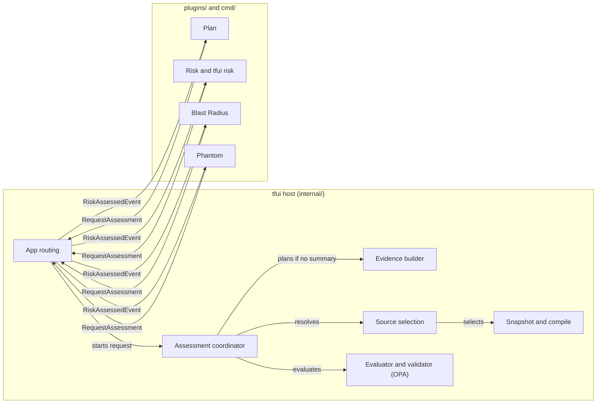
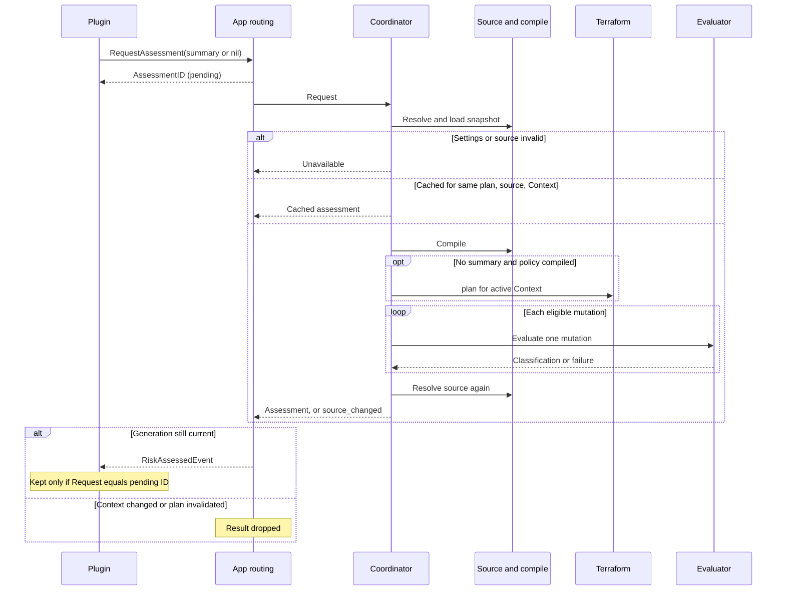
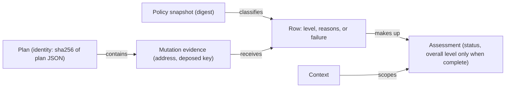

# Risk policy architecture

tfui classifies each planned resource mutation with a risk policy the project selects, written in Rego and
evaluated by an embedded Open Policy Agent (OPA). Plan, Risk, Blast Radius and `tfui risk` show those
classifications. This page explains why the feature is shaped the way it is and how its parts fit. The
[v1 contract](../reference/risk-policy-contract.md) states the interface a policy author or a script relies on.
[ADR-0024](../adr/0024-embed-rego-for-risk-policies.md) and
[ADR-0025](../adr/0025-classify-resource-mutations-explicitly.md) record the two choices that are costly to reverse.

The authoring contract is a one-way door: once a project writes policies and automation against it, changing
what a policy receives or must return breaks them. The evaluator behind it can be replaced more cheaply. The
first version shipped in [#121](https://github.com/lmarqs/terraform-ui/pull/121).

## Context

### Before the policy

tfui classified risk with fixed lists of actions and resource types in `internal/terraform/risk.go`. Plan showed
the levels as badges, and nobody could change a level without a tfui release. That classifier still runs when a
plan loads (`internal/terraform/loader.go:39`), and the policy's assessment replaces its levels once it arrives.

| Role | What they could do before #121 | Through what |
| --- | --- | --- |
| Infrastructure reviewer | Read fixed risk badges in Plan and an overall level in headless Plan text. | `plugins/plan`, `pkg/sdk/risk.go` |
| Project policy author | Nothing: the Risk plugin ignored its configuration options. | `plugins/risk/risk.go` |
| Automation author | Obtain a plan; no command reported risk. | `cmd/tfui/main.go` |
| Member maintainer | Nothing per Member: Member plugin blocks were rejected. | `internal/config` |

No usage or frequency figures were collected for these roles; the gap is a missing capability.

### What forced the change

[Field report #106](https://github.com/lmarqs/terraform-ui/issues/106) showed a change the fixed lists rate wrongly:
changing a Lambda function's package path uploads that package over code another pipeline deployed. The AWS
provider includes `filename` in its code-update check and calls `UpdateFunctionCode`
([provider source](https://github.com/hashicorp/terraform-provider-aws/blob/main/internal/service/lambda/function.go),
inspected 2026-11-14). Telling that change from a memory-only update needs the changed attributes, which a list of
resource types cannot see, and each project draws the line differently.

Blast Radius also reads each change's risk to score a module's impact, so a new risk representation changes its
numbers too. A failed assessment must not reach it as a zero severity.

### Goals

| Goal | Who benefits | How we know |
| --- | --- | --- |
| G1: See which planned mutations need attention, and why. | Reviewer | A mutation shows a classification and the reason its policy gave. |
| G2: Express project expectations without waiting for a tfui release. | Policy author | Editing the policy changes the classification; tfui is unchanged. |
| G3: Tell a completed assessment from a failed one before acting on it. | Reviewer, automation author | A failure never reads as a neutral result. |
| G4: Control a Member's assessment with no hidden contribution. | Member maintainer | The selected policy alone decides each classification. |

The repository owner speaks for these roles. Maintainers carry the OPA dependency and the contract's
compatibility; policy authors carry learning Rego and covering every mutation.

### Prior decisions and constraints

No law, contract or signed budget constrains this feature. Every shaping input is a decision made inside the
project:

| Prior decision | Who, when | Cost to reverse |
| --- | --- | --- |
| Evaluate Rego with embedded OPA; `tfui.hcl` selects a local source. | Owner, 2026-11-14, ADR-0024 | Migrate authored policies and the evaluator integration. |
| Classify each mutation independently and explicitly, with no fallback. | Owner, [#108](https://github.com/lmarqs/terraform-ui/issues/108), ADR-0025 | Change the meaning of existing classifications. |
| A Member's policy replaces its parent's; templates are copied, never inherited. | Owner, ADR-0024 | Add inheritance and upgrade semantics authors did not choose. |
| Apply does not change. | Owner, both ADRs | Reopen the execution and saved-plan lifecycle. |
| Plugins import only `pkg/sdk`. | [ADR-0001](../adr/0001-sdk-isolation-boundary.md) | Couple plugins to the evaluator. |
| Plan and Risk share action and diff presentation. | Owner's UI review | Duplicate formatters that diverge on masking and style. |
| The interface details (input shape, result shape, trust, aggregation, reporting) were chosen by contributors. | Delegated by the owner, 2026-11-15 | The owner revises them through the contract's versioning. |

Out of scope: gating `tfui apply`, rules that look across resources, sandboxing hostile policy code, and
distributing policies remotely.

## Requirements

Each requirement serves a goal and is proven by a test on `main`.

| ID | Goal | Requirement | Proof |
| --- | --- | --- | --- |
| R1 | G1, G2 | A policy classifies one resource mutation at a time and explains it; it sees no other resource. | `TestAssess_GivenCompleteCustomPolicy_ShouldClassifyEachResourceWithoutHiddenDefaults` |
| R2 | G1, G3 | Every eligible mutation gets an explicit classification, or the assessment fails. | `TestAssess_GivenUndefinedOrMalformedClassification_ShouldNeverReturnSuccessfulNone` |
| R3 | G2, G4 | A selected custom policy alone classifies; built-in rules never fill its gaps. | `TestAssess_GivenCustomLambdaOnlyPolicy_ShouldLeaveDatabaseUndefined`, `TestLoadSource_GivenInvalidSelection_ShouldFailWithoutBuiltinFallback` |
| R4 | G1, G3 | When assessment fails, the plan stays reviewable with risk marked unavailable, and `tfui risk` reports an error. | `TestRunPlugin_GivenLegacyRiskSetting_ShouldPreservePlanReviewWithUnavailableRisk`, `TestHandleRiskAssessed_GivenFailedOrUnavailableEvent_ShouldShowUnavailableImpact` |
| R5 | G1, G3 | Every view assesses the plan under review; assessing never runs a second plan for a plan already held. | `TestRequestAssessment_GivenValidPolicyAndNilSummary_ShouldPlanOnceAndPublishThatSummary`, `TestRequestAssessment_GivenCompleteAssessment_ShouldEvaluateOnceForRepeatedRequests` |
| R6 | G1, G2 | A rule can tell mutations apart by the attributes they change. | `TestAssess_GivenBuiltinLambdaEvidence_ShouldExplainInContractPriorityOrder` |
| R7 | G1, G4 | An assessment belongs to one plan, one policy source and one Context; a late or stale result is never shown as current. | `TestAdvance_GivenRequestIssuedBefore_ShouldDropItsResult`, `TestRequestAssessment_GivenSourceChangedDuringEvaluation_ShouldPublishSourceChanged` |
| R8 | G1 | Reviewers see the changed attributes beside the classification, drawn as Plan draws them. | Risk and Plan both draw diffs with `sdk.RenderAttributeDiffs` (`pkg/sdk/attribute_diff.go`); `plugins/risk/golden_test.go` |

There is no latency, memory or binary-size target: nobody set one, and the measured costs below were accepted as
they stand.

## Architecture

Every view and the CLI get risk the same way: the plugin asks the host, and the host owns policy loading,
planning, evaluation and staleness. A plugin never imports OPA or reads a policy
([architecture: risk assessment](architecture.md#risk-assessment)).

| Part | Code | What it does | Answers |
| --- | --- | --- | --- |
| Evidence builder | `internal/terraform/policy_evidence.go` | Turns `terraform show -json` into tagged per-mutation evidence with a plan identity. A deferred or malformed change fails the whole evidence. | R5, R6 |
| Source selection | `internal/config/risk_policy.go` | Resolves `risk_policy` for the active chdir and workspace; no selector means the built-in policy. | R3 |
| Snapshot and compile | `internal/riskpolicy/source.go`, `evaluator.go`, `capabilities.go` | Reads the complete source once into an immutable snapshot with a digest, and compiles it against the allowlisted builtins. | R3, R7 |
| Evaluator and validator | `internal/riskpolicy/evaluator.go`, `result.go` | Evaluates each eligible mutation alone and validates the result shape and reason paths. | R1, R2 |
| Assessment coordinator | `internal/riskassess/coordinator.go` | Runs each request: load, compile, plan if needed, evaluate, cache, re-check the source. | R4, R5, R7 |
| App routing | `internal/ui/app.go` | Starts requests, drops results from an earlier generation, and cancels on Context change or plan invalidation. | R7 |
| SDK types | `pkg/sdk/policy_assessment.go`, `events.go` | `PolicyAssessment`, `AssessmentID`, `RiskAssessedEvent`; rows keyed by address and deposed key. | R2, R7 |
| Consumers | `plugins/plan`, `risk`, `blastradius`, `phantom`; `cmd/tfui/risk_command.go` | Request an assessment and keep only the result carrying their pending ID; Risk also owns threshold comparison and the report. | R4, R8 |

*Figure 1. Component view inside the tfui process. Answers R1–R5, R7.*

A request runs in this order:

1. A plugin calls `RequestAssessment` on the Update loop with the plan summary it holds, or none. The host
   returns a new `AssessmentID` at once; the plugin records it as pending. A plugin's new request cancels its
   previous one.
2. The coordinator resolves the policy source for the captured Context and loads its snapshot. Invalid settings or
   an unreadable source end the request as unavailable before any plan runs.
3. When the plugin supplied a summary, a cached result for the same Context, plan identity, selection and source
   digest is returned without compiling.
4. The policy compiles. With no summary, a broken policy ends the request as unavailable; a compiled one lets the
   coordinator run `terraform plan` for the active Context.
5. Each eligible mutation is evaluated alone and its result validated.
6. The coordinator resolves the source again; if it changed, the result becomes `source_changed`. Only a usable
   assessment is cached, so a retry after a failure evaluates again.
7. The App dispatches the event only if no Context change or plan invalidation happened since the request
   started, and each plugin keeps it only if it carries its pending ID.

*Figure 2. Request sequence, component level. Answers R2, R4, R5, R7.*

*Figure 3. Data ownership. Answers R1–R3, R7.*

An assessment's status is complete, empty, partial or unavailable. Only a complete one has an overall level, and
Blast Radius scores a module group only when every assessed row in it classified; a group with a missing or failed
row shows as unavailable, never as zero.

## Options weighed

Drivers, in order: explicit classification each mutation can explain (R1–R4); project ownership with no hidden
contribution (R3); evidence from the plan under review (R5–R7); reusable authoring and testing tools against
maintenance cost; shared presentation (R8).

Every integrated option needs the same evidence builder, eligibility rules, validation, Context identity and
report semantics. Choosing OPA removed none of that work. Impact and likelihood are reasoned estimates, not
measured incident rates.

| Option | Requirements | For | Against | Impact / likelihood | Mitigation | Contingency |
| --- | --- | --- | --- | --- | --- | --- |
| Baseline: fixed classifier plus a Lambda rule | R1, R6 for built-in cases; misses R3 | Small change, nothing to learn | Each new rule needs a release | Medium / high: customization was requested | Document the fixed rules | Make classification configurable |
| Custom HCL or YAML matcher | R1–R3, R6 within its operators | Easy for small policies | tfui owns a growing language, its precedence and its tests | High / medium: attribute cases keep adding operators | Bound the operators | Migrate authored rules |
| Embedded CEL predicates | R1–R7 with an envelope and a test harness | Fits per-mutation predicates | tfui still owns the policy document, results and test conventions | Medium / medium | Keep the envelope narrow | Move to a standard policy language |
| **Embedded Rego (chosen)** | R1–R8 | Standard language with author test tooling | Learning Rego; OPA upgrades; 15.0–16.2MiB larger binary | High maintenance / medium | Pinned OPA v1.19.1, allowlisted builtins, trusted authors | Revise the pin and profile explicitly and rerun the controls |
| External OPA or Conftest | R1–R7 with adaptation | Evaluator upgrades independent of tfui | Users install and version a second tool; tfui manages a process | Medium / medium for CLI users | Supported version and explicit discovery | Embed the evaluator |
| External CI only | R1–R3, R6; misses R5, R8 | Least tfui work | Review and automation see different evidence | High / high | Share inputs and fixtures | Integrate the assessment |
| Plan-wide policy | Fails R1 | Rules over combined changes | A resource's level depends on other changes | High / high by definition | A separate, explicit contract | A separate feature |
| Sparse results with built-in fallback | Fails R2, R3 | Authors write only exceptions | A missing result silently changes ownership | High / high by definition | Explicit default in the policy | Fail the incomplete assessment |
| Suppress phantom mutations automatically | Fails R2 | Less noise | Normalization can hide a meaningful array or null change | High / medium | Submit them like any mutation | Review the heuristic separately |
| Merge parent policies or named presets | Merging fails R3 | Less copied source | Hidden effective policy and upgrade rules | High / medium | Copied templates | Explicit composition, decided separately |
| Plugin-local diff rendering | Fails R8 | Fast to build in isolation | Divergent styles and masking | Medium / medium | Shared SDK renderer | Consolidate the renderers |

Gating Apply was weighed as a place to enforce risk. It reverses the owner's scope and adds execution obligations
without improving classification, so it stays out.

## Costs and evidence

**Measured**, [D-03c](https://github.com/lmarqs/terraform-ui/blob/research/risk-plugin/docs/development/risk-policy-evidence/release-costs.md),
with a small policy on Linux/amd64 before #121: embedding OPA grows the binary by 15.0–16.2MiB (about 177%) and a
cold build by 12.6–13.0 seconds; the warm median evaluation over 1000 runs is 23.049µs per mutation, with a
maximum observed RSS of 28.375MiB. These are accepted costs, not budgets, and they say nothing about a large
policy's worst case or other platforms.

The [OPA runtime research](https://github.com/lmarqs/terraform-ui/blob/research/risk-plugin/docs/development/risk-policy-runtime-research.md)
found that an undefined query returns no Go error, that suppressing `print` cannot keep a secret out of a returned
value, and that cancellation is cooperative. The validator and the trust model follow from those three facts.
[D-02a](https://github.com/lmarqs/terraform-ui/blob/research/risk-plugin/docs/development/risk-policy-evidence/input-fidelity.md)
showed that the plan's display strings lose numbers, which is why the input is tagged.

## Risks that remain

| Risk | What limits it | If it happens |
| --- | --- | --- |
| A policy explains with a secret it was not given masked, or authored text leaks one. | Trusted local authors; marked values redacted before evaluation; fixed diagnostics. | Correct the input marking; tfui does not certify confidentiality. |
| A slow or non-terminating trusted policy. | Cooperative cancellation when the user leaves or the Context changes. | Hard isolation needs its own design. |
| An OPA upgrade changes evaluation or the builtin profile. | The capability digest test compares the full profile. | Revise the pin and profile explicitly. |
| Phantom gets its plan through the assessment request, so a policy that fails to load leaves Phantom without a plan. | Phantom shows `plan unavailable` with the reason. | [#156](https://github.com/lmarqs/terraform-ui/issues/156) tracks a plan-only request. |
| A provider version changes which attributes a mutation touches. | Reasons name evidence, never inferred ownership. | Correct the rule and its fixture. |

## What the first fixes taught

The follow-ups after #121 all landed on identity and lifetime, not on evaluation:

- **Cancellation is per requester.** The first coordinator's cancel reached every pending request; one plugin
  leaving cancelled another's ([#138](https://github.com/lmarqs/terraform-ui/pull/138)).
- **Cache only what is usable.** A cached failure answered every retry
  ([#157](https://github.com/lmarqs/terraform-ui/pull/157)). Checking the cache before compiling spares a repeated
  request the compile ([#138](https://github.com/lmarqs/terraform-ui/pull/138)).
- **A resource instance is address plus deposed key.** A replacement's deposed object shared its address with the
  new one ([#151](https://github.com/lmarqs/terraform-ui/pull/151)).
- **A busy assessment must not hold the screen.** A policy-only assessment blocked navigation
  ([#130](https://github.com/lmarqs/terraform-ui/pull/130), [#131](https://github.com/lmarqs/terraform-ui/pull/131)).
- **A failure names its step.** `tfui risk` errors now say which step failed, and no diagnostic prints empty
  ([#135](https://github.com/lmarqs/terraform-ui/pull/135), [#167](https://github.com/lmarqs/terraform-ui/pull/167)).

## History

- 2026-11-14: Rego with embedded OPA accepted (ADR-0024); scope and explicit ownership settled in #108 (ADR-0025).
- 2026-11-15: interface details chosen under delegation after the D-02 and D-03 experiments; the v1 contract published.
- [#121](https://github.com/lmarqs/terraform-ui/pull/121): first version shipped in Plan, Risk and `tfui risk`.
- #130 to #167: the fixes above, plus symlinked sources ([#133](https://github.com/lmarqs/terraform-ui/pull/133)),
  partly unknown attributes ([#136](https://github.com/lmarqs/terraform-ui/pull/136)), and Phantom planning when
  opened ([#158](https://github.com/lmarqs/terraform-ui/pull/158)).
